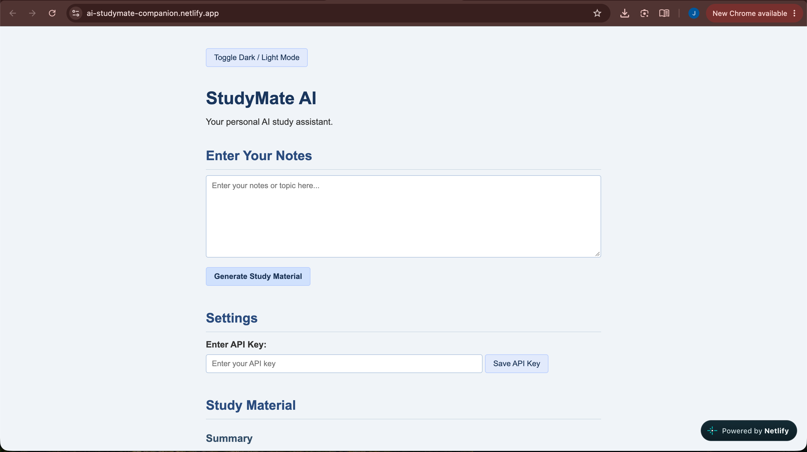
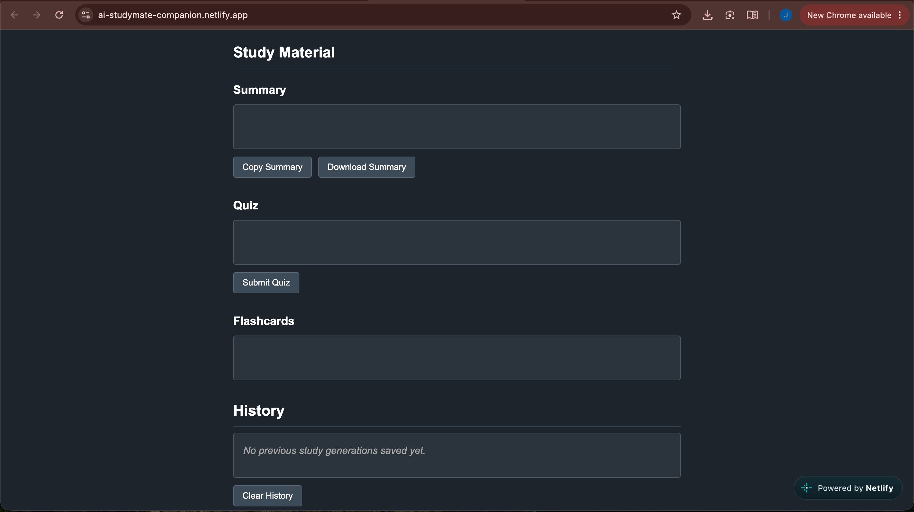

# StudyMate AI – Personal AI Study Assistant

StudyMate AI is an AI-powered study assistant that helps students learn more effectively by converting their study notes into summaries, quizzes, and interactive flashcards using the Google Gemini API.

## Features

- **AI Summary:** Converts study notes into simple and understandable summaries.
- **AI Quiz:** Generates exactly 5 multiple-choice questions from the provided notes.
- **Quiz Evaluation:** Calculates scores and displays correct answers with explanations.
- **Interactive Flashcards:** Click on flashcards to reveal their answers.
- **Copy Summary:** Copy generated summaries to the clipboard.
- **Download Summary:** Download summaries as text files.
- **Study History:** Saves previous study sessions using Local Storage.
- **Dark and Light Mode:** Switch between dark and light themes.
- **Responsive Design:** Supports desktop and mobile screens.
- **Error Handling:** Handles missing API keys, empty input, network errors, and API errors.

## Technologies Used

- HTML5
- CSS3
- JavaScript (Vanilla JavaScript)
- Google Gemini API
- Fetch API
- Local Storage

## Project Structure

```text
StudyMate-AI/
├── index.html
├── style.css
├── script.js
└── README.md
```

## Getting a Gemini API Key

1. Visit [Google AI Studio](https://aistudio.google.com/apikey).
2. Sign in using your Google account.
3. Create a Gemini API key.
4. Copy the generated key.

## How to Run the Project

1. Clone this repository:

```bash
git clone https://github.com/agrawaljinish-design/StudyMate-AI.git
```

2. Open the project folder in VS Code.
3. Run `index.html` using Live Server.
4. Enter your Gemini API key in the API Key Settings section.
5. Click Save API Key.
6. Enter your study notes and click Generate Study Material.

## API Key Security

The API key is entered by the user and stored in browser Local Storage for this academic demonstration.

The API key is not hardcoded into the project files or committed to GitHub.

**Note:** Browser-side API keys are visible to users. A production application should use a secure backend to protect API keys.

## Author

Developed as a Web Technology academic assignment.

## GitHub Repository

[StudyMate AI](https://github.com/agrawaljinish-design/StudyMate-AI)

## 📸 Application Screenshots

### Screenshot 1


### Screenshot 2


## 🚀 Live Demo

**Try StudyMate AI here:** [Open Live Website](## 🚀 Live Demo

**Try StudyMate AI here:** [Open Live Website](https://ai-studymate-companion.netlify.app))